# The Millionaire Game 2.0

A Windows desktop **game controller** for running live *"Who Wants to Be a Millionaire?"*-style shows
at home, on Discord, or on a YouTube/Twitch livestream. An operator drives the game from a Control Panel;
dedicated Host, Contestant and Audience/TV windows go on separate monitors or capture sources.

A tour of the game: what it looks like and how a show runs. The source code lives in a separate, private repository.

| TV / audience screen | Host screen |
|---|---|
| 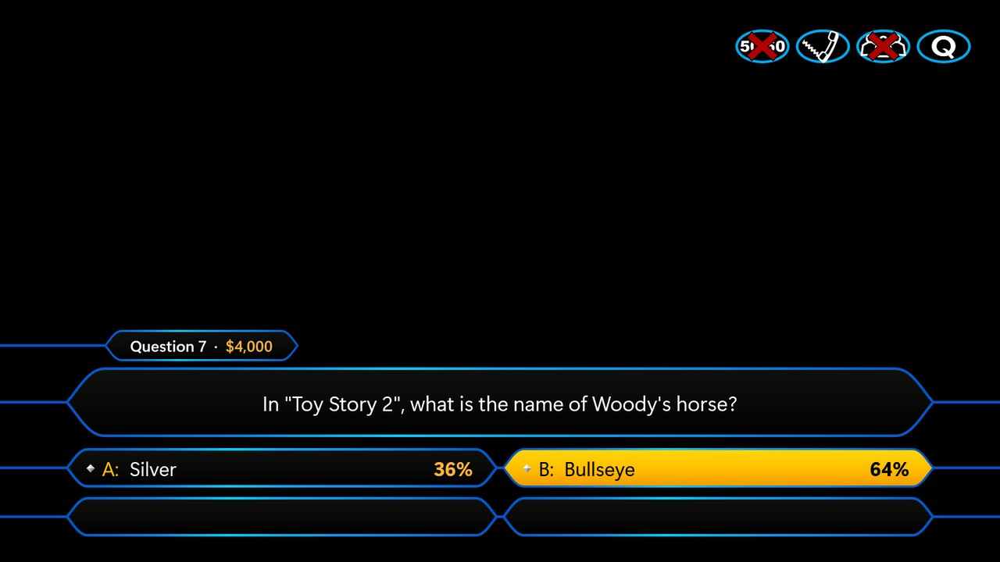 | 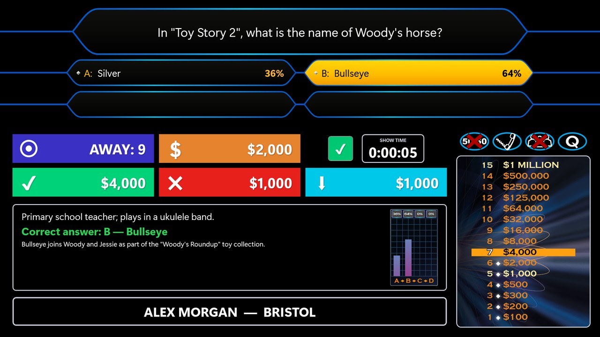 |

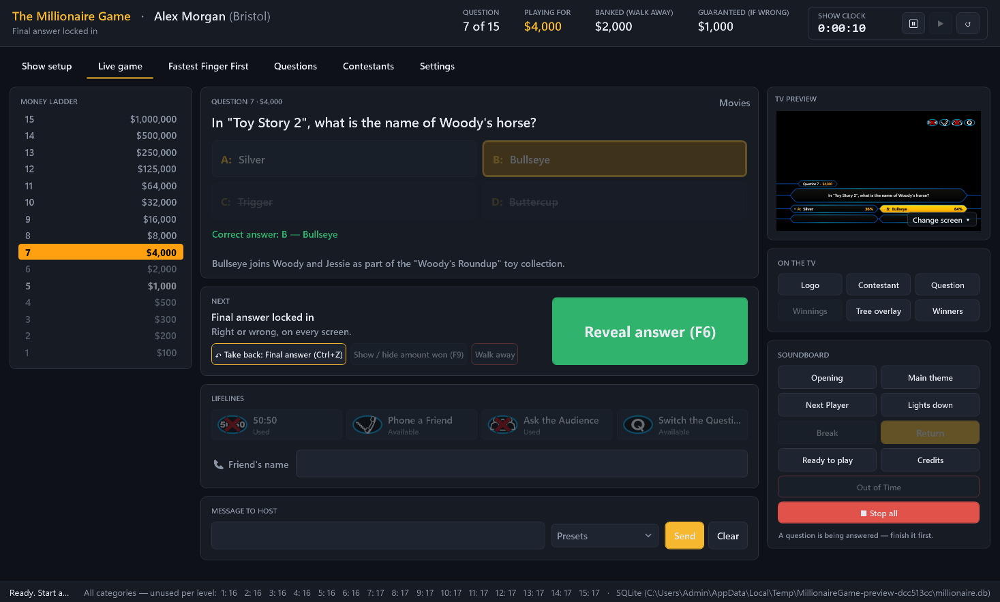

## Running a show

The Control Panel opens on **Show setup** (everything you set once before the show); the game itself is run from **Live game**.

1. **Open the screens** on *Show setup*: switch on **Host**, **Contestant** and **TV / Audience** (or **Open them all**).
   - Pick each screen's monitor from its list, and **⛶ Fullscreen**. On the screen itself, F11 or a double-click also toggles fullscreen and Esc exits.
   - Placements are remembered between runs.
   - **Ready for the show?** beside them checks the screens, the sound files, the questions left, phone voting and the show clock,
     with a button to fix each one. The props to print and **Single player…** are on this tab too.
2. On **Live game**, choose the contestant under *Next game* (or **🎲** for a random one), then press the big green button: **New game** →
   optionally **Risk Mode** (under *Next game*) → **Start game ▶**.
   - Between games the left column has *Next game* and *Explain the rules*; during a game it shows the contestant's **money ladder**.
   - The big green button is always the **next step** (Show question, Reveal next answer, Final answer, Reveal answer, Next question,
     Start the clock, Walk-away music, New game…), with Take back, the amount won and Walk away in a row beside it. Buttons that only
     sometimes apply (Reveal all answers, Reveal switched answer) show only then.
   - **Question category** (in the same card) picks where tonight's questions come from, e.g. *General Knowledge*, or *All categories (mixed)*.
     It shows how many games' worth are left and warns before a game would run out at some level. Fastest Finger rounds use it too,
     it's remembered between runs, and a game keeps its category once it has started (and when it carries on after a restart).
3. **Each question:** **Lights down** → **Show question** → **Reveal next answer** (F8) until all four show.
   - Select the contestant's answer with F1–F4, then **Final answer** (F5) → **Reveal answer** (F6) → **Next question** (F7).
   - **Take back** (Ctrl+Z) undoes a mis-press, one step at a time: the wrong letter locked in, Reveal a moment too early, a lifeline by accident.
     The game, screens and music go back to how they were. A finished game that's taken back takes the contestant's result with it.
4. **Lifelines** use Ctrl+1–4 or the buttons. Phone a Friend and Ask the Audience have two steps:
   - The lead-in plays first.
   - Phone a Friend rings twice and connects by itself; then press **Start the clock** when the host has read the
     question. For Ask the Audience, press **Open audience voting**.
   - Finish with **Complete lifeline**.
5. **On the TV** controls what the Contestant and TV screens display: logo, contestant intro, question, winnings, or the money-tree overlay beside the question.
   - The Host screen always shows the live game, including the correct answer and host notes.

   - **Walk away** asks "is that their final answer?" on the Live game tab itself (no pop-up): **Yes, walk away** (or press
     Walk away again) and the music fades. Then **Show what they'd have won**, then **♪ Walk-away music**: the TV shows
     their total prize money and the contestant's screen goes black.
   - **🧹 Clear the screens** (Live game, once a game is over, and on the Fastest Finger First tab) takes the last game off
     every screen, the host's too, so they show the logo, ready to introduce the next Fastest Finger players.
6. **After Switch the Question**, **Reveal switched answer** shows everyone what the discarded question's answer was.
   The Host screen sees it straight away.
7. **Soundboard:** **Opening** (the opening titles on every screen, to the opening theme, finishing on the logo), Main theme, Next Player (plays by itself when the FFF winner goes to the hot seat), Lights down (the Next Player music fades out under it), **Break** / **Return** (commercial breaks), **Ready to play**, **Credits**, **Out of Time** and **Stop all**.
   - **Back from a break:** Return puts the contestant in the hot seat on the screens (the host's desk shows their
     details). **Ready to play** then brings up the empty question board with the money tree beside it, and each lifeline
     button lights that lifeline up on the tree, with its sting, until the next question is shown.
8. **Winners** (On the TV) puts tonight's winners on every screen: everyone who has played since the contestants were last reset, biggest winnings first.
9. **The top prize:** ticker tape pours down over the contestant and TV screens at the reveal, and again on the total-winnings screen.

### Keyboard shortcuts

Every main-game button can have a key: **Settings → Keyboard shortcuts** (click a key, then press the one you want).
The defaults are F1–F4 (select A–D), F5 (final answer), F6 (reveal answer), F7 (next question), F8 (reveal next answer),
F9 (amount won), Ctrl+1–4 (lifelines) and Ctrl+Z (take back). The keys also work when a show screen has focus, so a
keypad, presenter clicker or Stream Deck that sends keys can run the game.

### If the game closes mid-game

The game in progress is saved after every step. If the app is closed or crashes part-way through, the Control Panel
offers to **carry on** next time: the same contestant, question, lifelines and money, under the rules the game started
with. The question goes back on the TV with its music.

### Single player

**Single player…** on the Control Panel's Show setup tab opens a game for one person with no host: the computer hosts, and
the player clicks their own answers on the TV screen. The Control Panel is hidden while they play (it shows the
answers) and comes back when they close the window.

- **Menu:** the logo, then one row: the player's name, the question category (flip through them with ◀ ▶ or the
  ↑ ↓ keys) and **Play** (or Enter). If the category has been played out, it asks before marking its questions unused.
- **Playing:** click an answer (or press A–D), then **Yes** to "Final answer?" (Enter) or **No** (Esc). The game reads
  out each question, reveals the result with the show's pauses, shows the amount won beside the money tree and moves
  on by itself. Space, or a click, skips a pause.
- **Lifelines:** click one (or press 1–4). 50:50, Switch the Question and Double Dip work as usual. Ask the Audience
  shows a simulated poll. Phone a Friend, Plus One and Ask the Host are played by a simulated friend who is usually
  right on the early questions, shakier near the top, and now and then confidently wrong. The phone rings until the
  friend picks up, and sometimes they are still torn between two answers when the 30 seconds run out.
- **Walk away:** the button at the top left (or W), then Yes.
- **Results:** the player goes on the winners' board as "Name · Solo game". Questions are marked used as in a hosted
  game. The show clock, saved games and automatic credits stay out of single player.

| Single player menu | Phone a Friend |
|---|---|
| 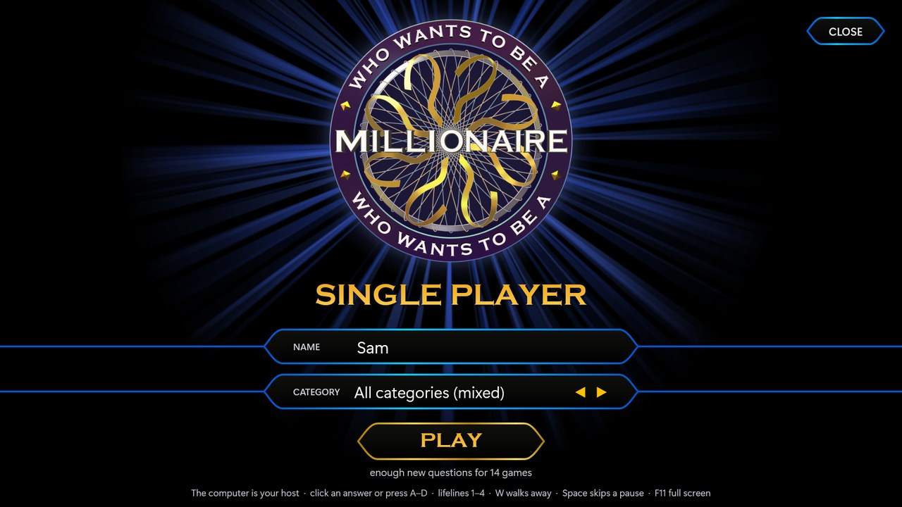 | 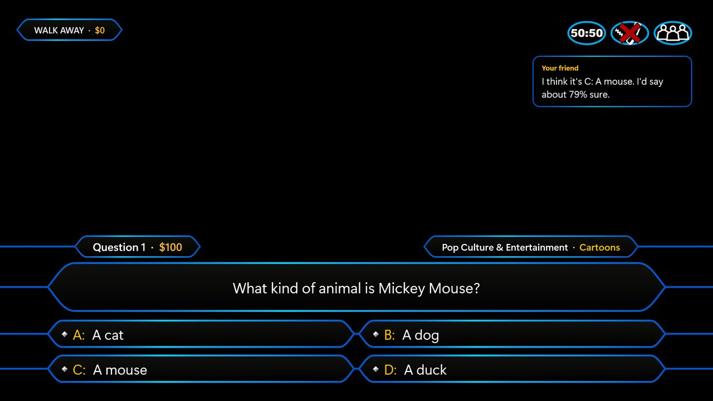 |

| Final answer? | Game over |
|---|---|
| 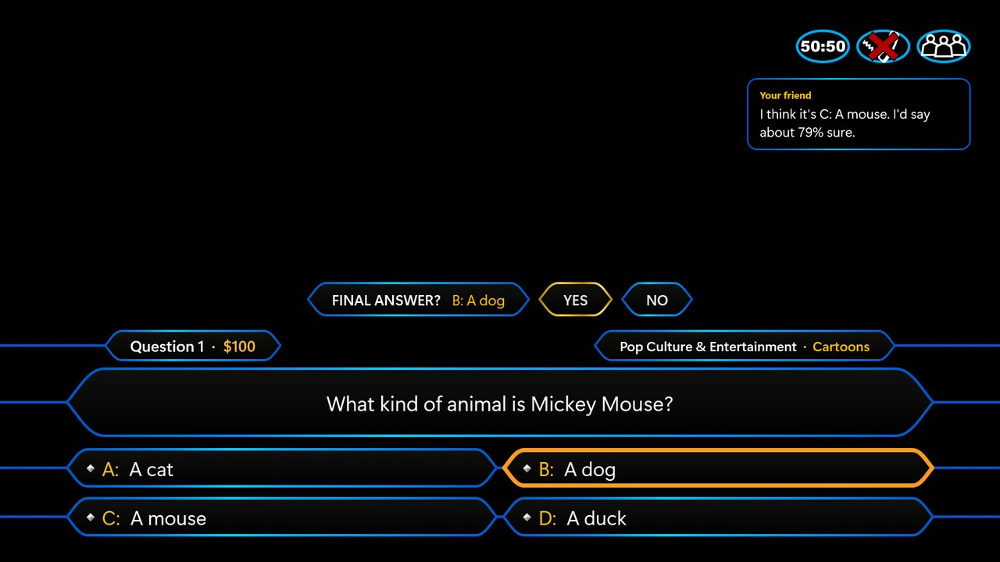 | 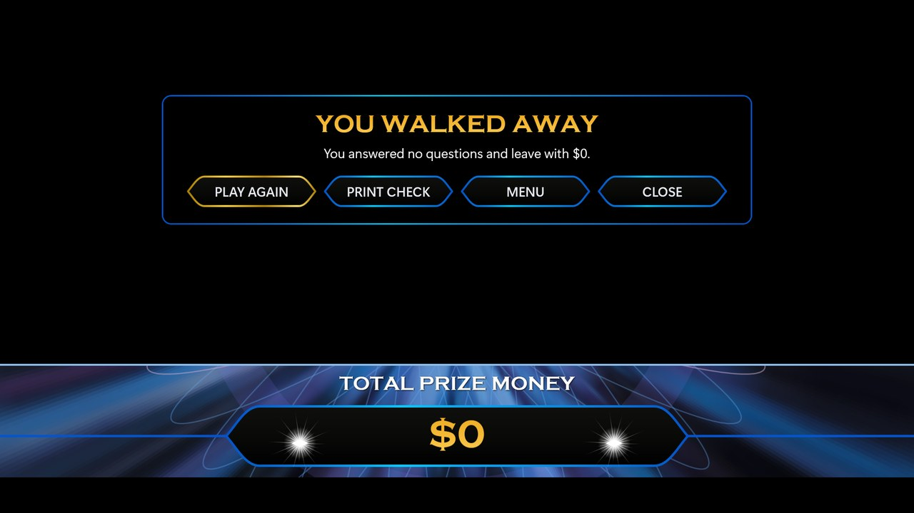 |

### Printed props

**Props to print** on the Control Panel's Show setup tab has three props, all drawn by the game:

- **Winner's check…** (once a game is over): a pale green check from the "First Bank of Make-Believe", made out to the
  contestant for what they won, with the amount in words, the date and a memo ("8 questions answered · Sports Cars").
  It prints across one sheet of paper on its side, or saves as a picture. It says it's not real in four places.
- **Badges…**: lanyard badges in a colour for each role (Host, Crew, Contestant, Audience). Type one name to a line,
  or ask for blank ones with a white strap to write on. Contestants are filled in from the Contestants tab. They print
  six to a Letter sheet at 2⅔ × 4 inches (to fit a 3 × 4 inch vertical badge holder), with dashed lines to cut along,
  or save as one picture each.
- **QR poster…** (once online play is on): a Letter-size poster with the logo and two codes. Code 1 joins the guest
  Wi-Fi in one tap (set its name and password in **Settings → Phone voting & Wi-Fi**); code 2 opens the voting page. With no guest
  Wi-Fi set, it's one big voting code. The codes use this computer's address tonight, so print it on the night.

| Winner's check |
|---|
| 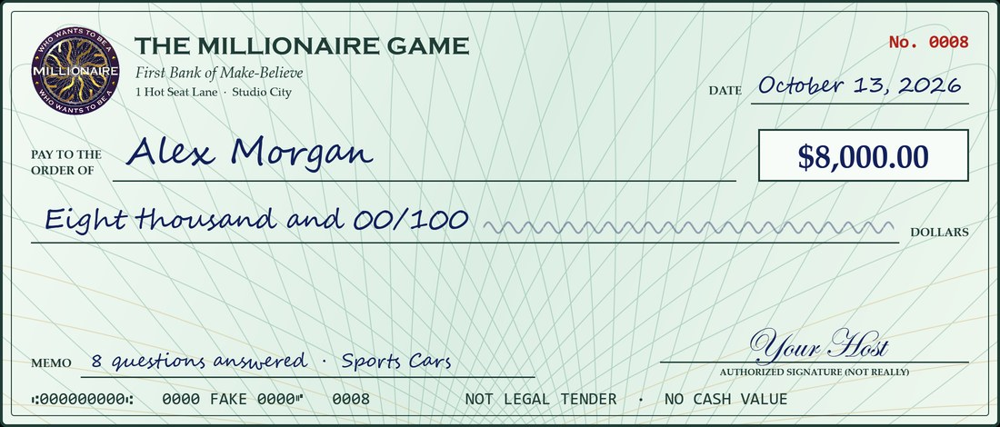 |

| Badges: host, crew, contestants and audience |
|---|
| 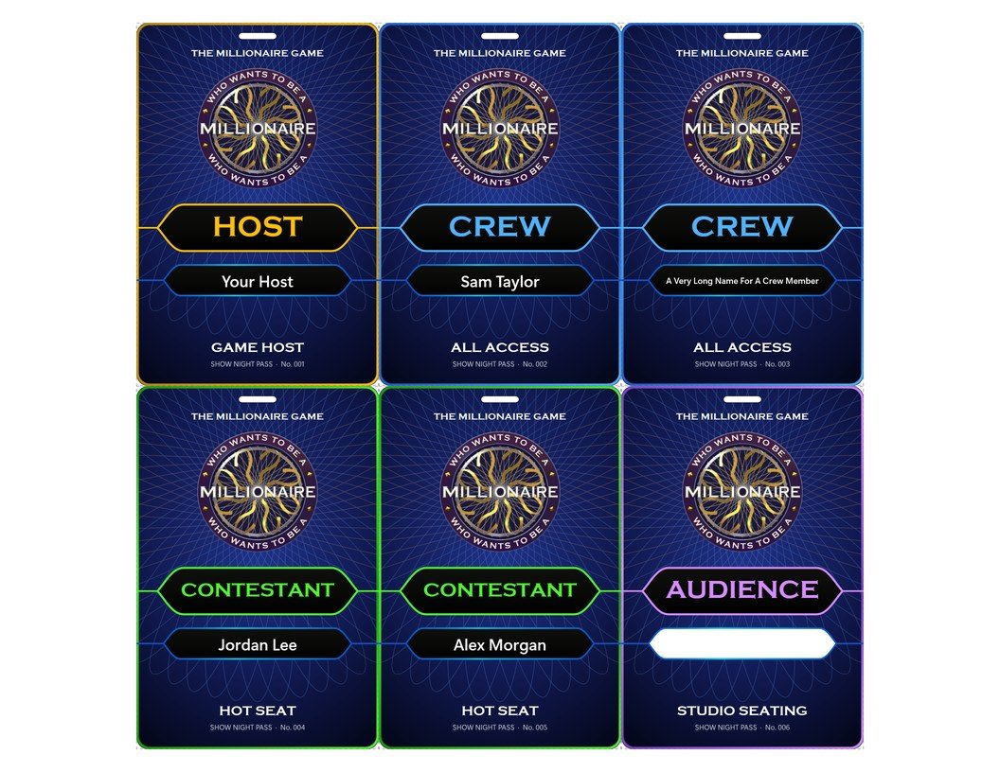 |

| QR poster — Wi-Fi and voting | QR poster — voting only |
|---|---|
| 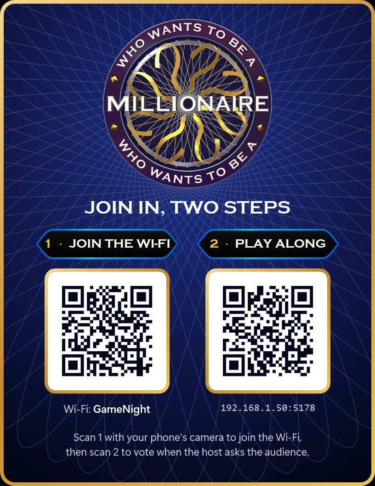 | 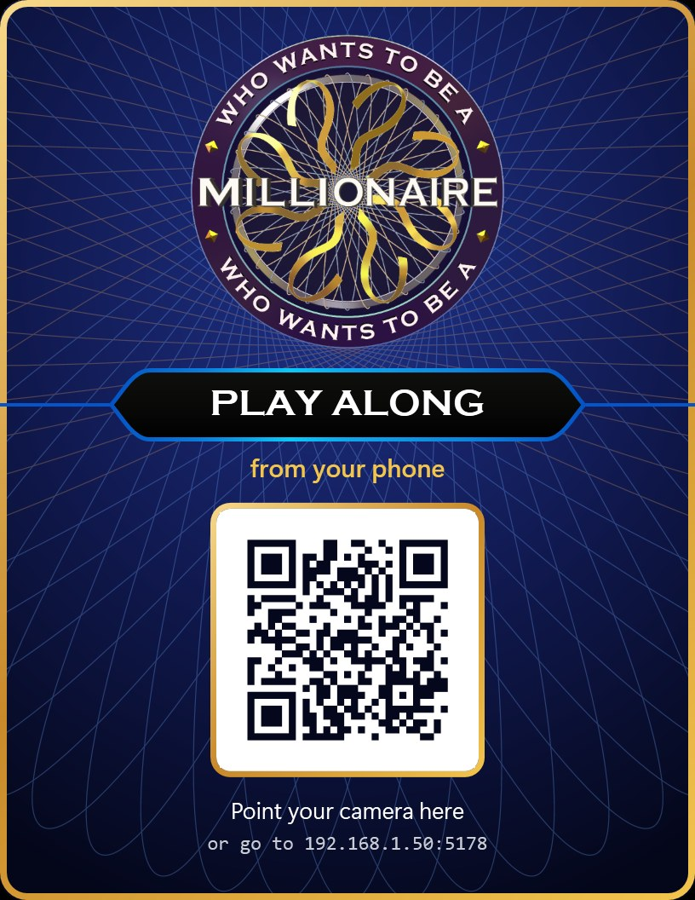 |

### Show clock, Out of Time and end credits

- **Show length** (Settings → *Show clock*): no limit, or 15 minutes to 3 hours. The clock starts with the first game and runs across games.
  It sits in the Control Panel's top bar (⏸ ▶ ↺), and optionally on the Host screen, never on the contestant or TV screens.
- **When time runs out** the clock stops, **Next question** greys out and a red **Out of Time** button appears.
  It can only be pressed once the question in play has been answered: every sound stops, the time's-up cue plays,
  and the host sees TIME'S UP. The game ends there: the contestant keeps what they've banked, the question leaves
  the screens for what they've won, and the next step is **♪ Walk-away music**. **Take back** (Ctrl+Z) puts the game
  back if they're to carry on after all; **Keep playing** (before or after) carries on the show.
- **End credits** roll on every screen to the closing theme, timed so the company card lands on its final chord.
  After time's up they roll by themselves once the game is over and the walk-away music has played (Settings → *End credits*, which also holds the host and question credits).

### First run, editors and settings

- **Setup wizard:** runs on first start and covers the database (SQLite or SQL Server, with a connection test), the lifeline set, the sound pack folder, and a monitor for each screen.
  - **Skip — use defaults** starts straight away.
- **Questions tab:** search and filter by level or usage, and add, edit or delete main-game and Fastest Finger questions.
  - **Categories:** the row of chips at the top shows one category (or all of them). **+ New category**, **Rename…** and **Delete…**
    work on whole categories; **Move to category** in the bulk bar moves ticked questions. Within a category, each question has a
    **topic** (e.g. *Coven* in *American Horror Story*), with its own filter.
  - Import and export JSON or CSV, and reset usage for one level or all (within the category shown). **Import…** asks which
    category the file's questions go in.
- **Contestants tab:** tonight's two lists. **Still to play** is the running order: drag to reorder, and the top one is
  *up next* on Live game's *Next game*; type a name in the box below it and press Enter to add someone. **Already played** is
  tonight's leaderboard, biggest winnings first, with how each game ended ("walked away after Q10"; solo games are marked). Name,
  hometown and notes for the host are edited on the right. **Everyone can play again** resets them for a new show (the running order stays).
- **Settings tab:** a sidebar of pages, one shown at a time, with a search box (type "volume", "wifi", "credits"…).
  - **The game:** Money tree (classic or a custom ladder, in US dollars) · Lifelines (four slots: type, unlock rule, clock,
    name on screen; where Ask the Audience's results come from and how long its graph stays up; Switch the Question) ·
    Game rules & modes (Risk Mode, Free Safety Net Mode, the amount-won banner).
  - **The show:** Screens & monitors (contestant money tree, TV chroma key) · Animations · Show clock · End credits.
  - **Sound:** Volume & sound pack (volumes, pack folder, output device) · Sound cues (a file for every cue).
  - **Audience & phones:** Phone voting & Wi-Fi, with a **Ready for the audience?** checklist that checks the server, the
    vote source and the guest Wi-Fi, shows the voting address and counts the phones connected, with one-click fixes ·
    Online Fastest Finger (joining over the network, port, join code, FFF timing).
  - **System:** Keyboard shortcuts · Database.
  - The save bar stays at the bottom and names the pages with unsaved changes (they get a dot in the sidebar too).
  - Settings are validated before saving. Game rules apply from the next **New game**, sound changes apply immediately, and a database change needs a restart.

| Questions editor | Settings |
|---|---|
| 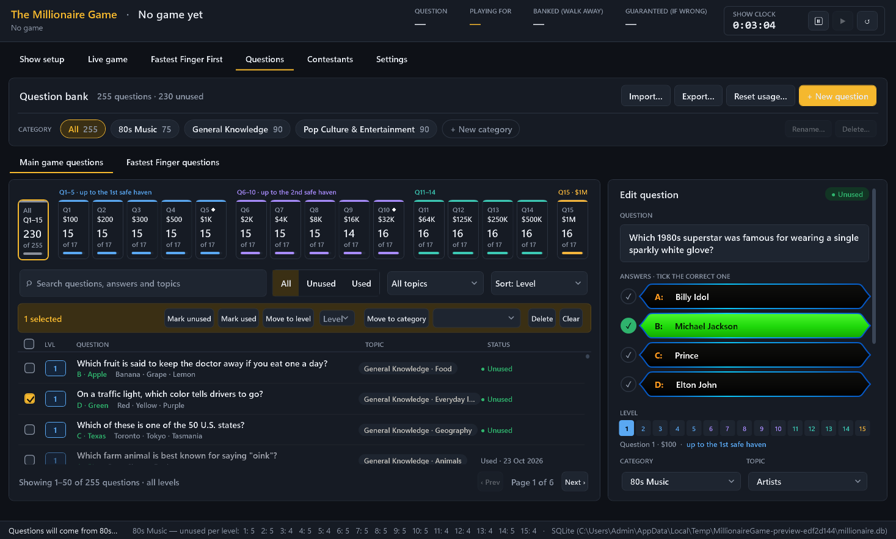 | 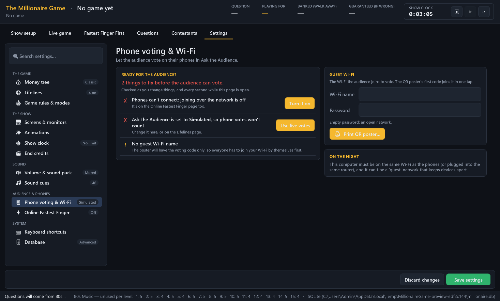 |

| Contestants |
|---|
| 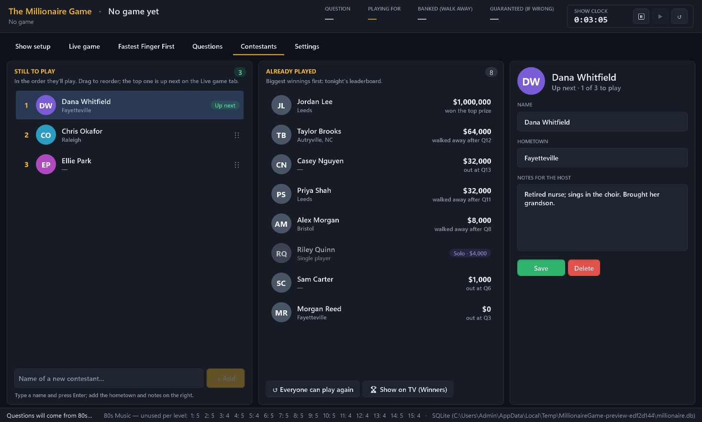 |

### More screens

| How to play | Correct, with the money tree |
|---|---|
| 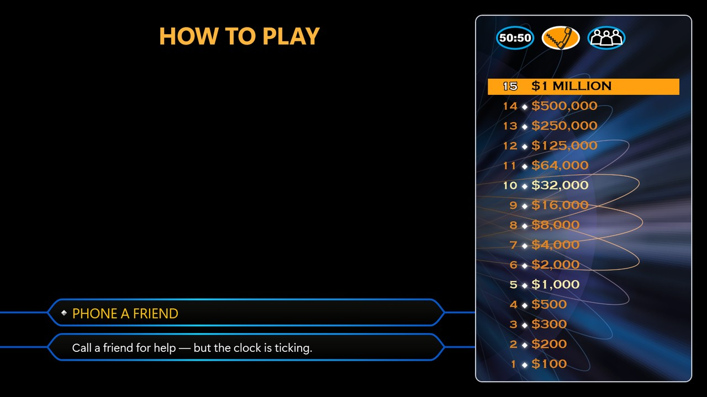 | 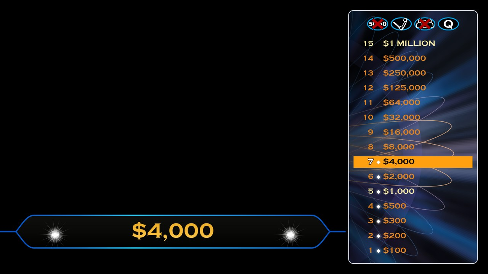 |

| Amount won | Contestant screen |
|---|---|
| 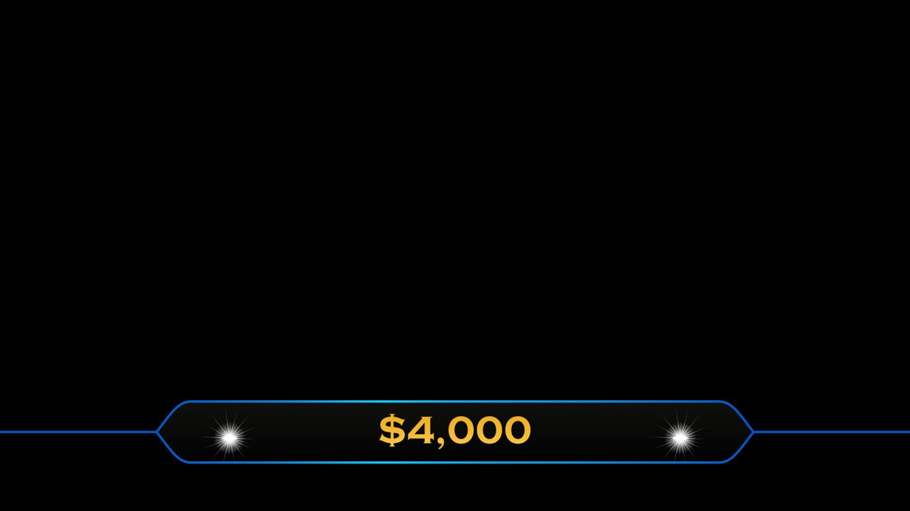 | 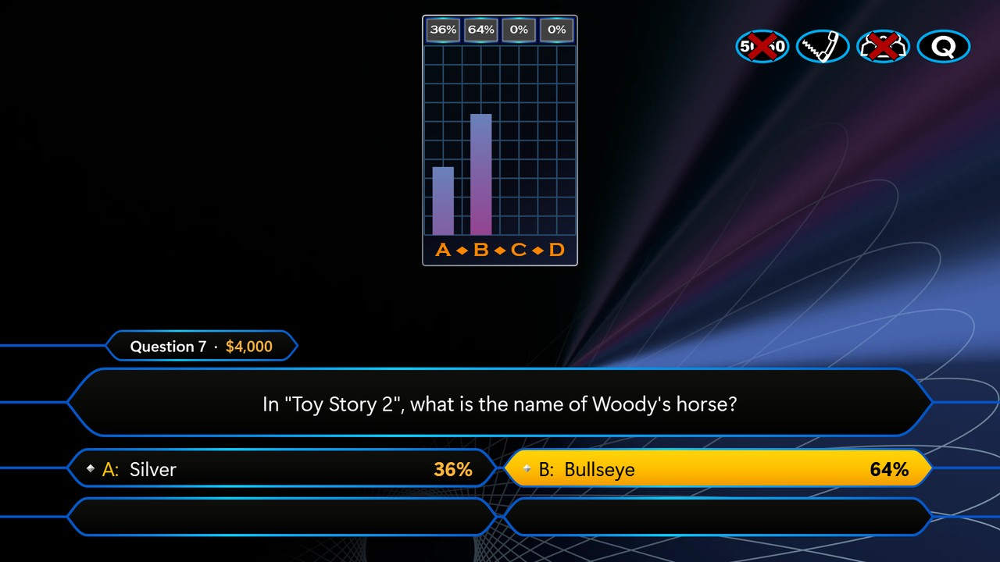 |

| Switch the Question | Total winnings |
|---|---|
| 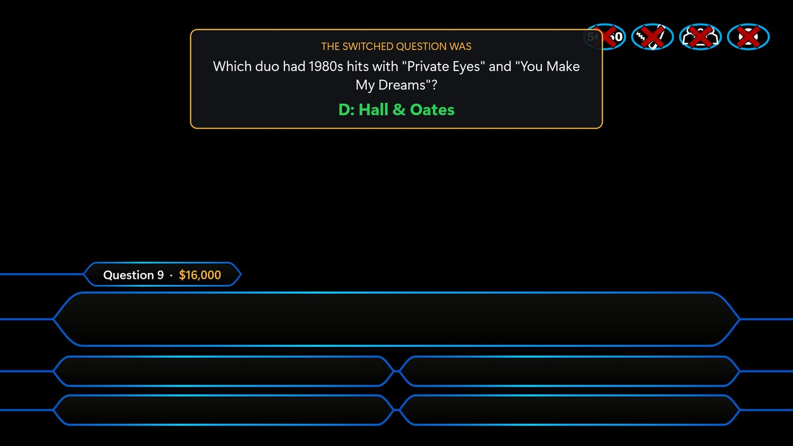 | 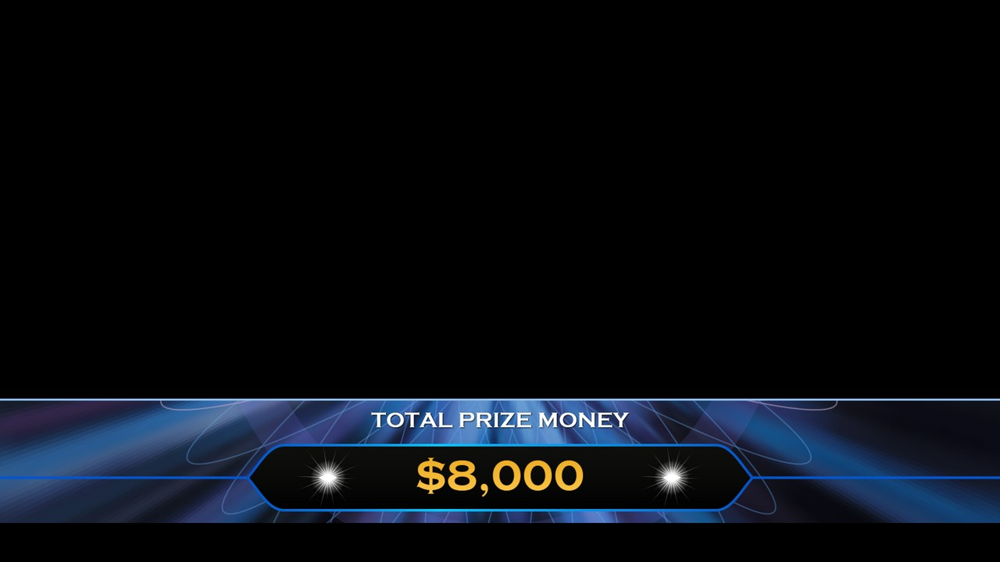 |

| Back from a break | Ready to play: the lifelines left, lit on the tree |
|---|---|
|  | 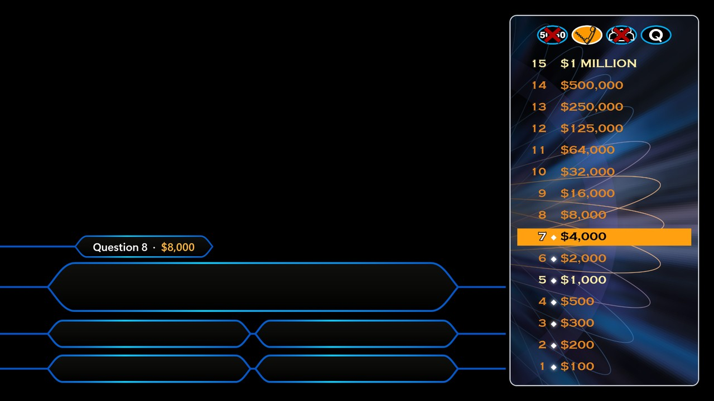 |

| Commercial break | Fastest Finger First results |
|---|---|
|  | 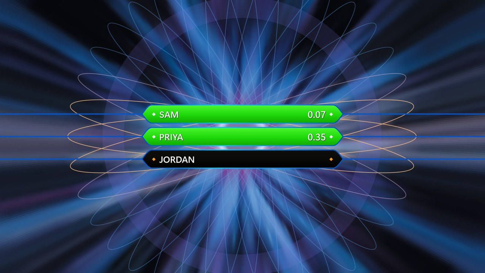 |

| End credits | Company card |
|---|---|
| 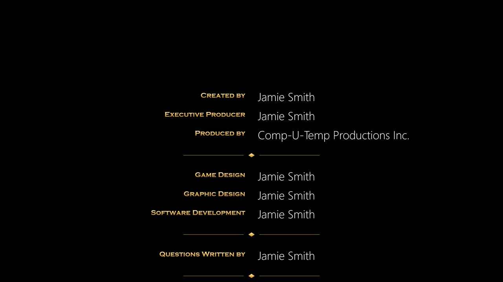 |  |

| Setup wizard |
|---|
| 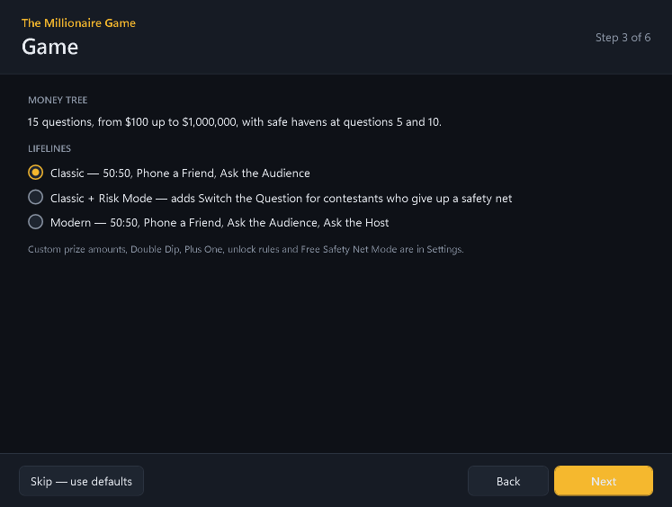 |

Every screen draws on a fixed 1920×1080 canvas that scales to any resolution, so 1080p, 1440p and 4K all look identical.

### Online Fastest Finger First and live audience voting

1. In **Settings → Online Fastest Finger**, turn on **Allow players and phones to join over the network**.
   - Optionally set a **join code**.
   - The server starts immediately; no restart is needed.
   - The first time, Windows may ask whether to allow the game through the firewall. Allow it for **private networks**.
2. The **Fastest Finger First** tab shows the address players connect to, e.g. `192.168.1.20:5178`.
3. **Players** run `MillionaireFff.exe` (the FFF client), enter that address and their name, and join.
   - A player outside your network can get a one-file copy with your address already filled in (your router must
     forward that port to the PC running the game).
   - They see the question the moment you press **Start clock**.
   - They put the items in order by clicking, or with the A–D keys (Backspace to undo, Enter to submit).
   - They get their result at the end.
   - Timing is measured by the game when each answer arrives, so a slow PC can't cheat.
   - If a player's connection drops, the client reconnects and rejoins as the same player.
4. **Audience voting:** open **Settings → Phone voting & Wi-Fi** and work through **Ready for the audience?** (its
   **Use live votes** button sets Ask the Audience to live votes). Once phones scan the poster, it counts them.
   - The audience opens `http://<address>/vote` on their phones (or scans the **QR poster**). It's a web page, so
     nothing needs installing.
   - Every phone first shows a **Just for Fun!** notice (no real money is played for; any prizes are small ones) and
     taps **I Understand** before joining; it's asked again after 12 hours. Set who provides tonight's prizes, such
     as the church or venue, under **Just for fun** on the same Settings page.
   - Until voting opens, phones show the logo and "You're in!". When you press **Open audience voting**, they show the
     question and the four answers (minus any 50:50 took away). Each phone gets one vote and can change it until
     voting closes, then it says "Voting is closed" with their answer.
   - Phones must be on the same network as the game computer. If you bring your own router, plug the computer into it
     and don't use its "guest" network, which keeps devices apart.
   - The live count shows next to the lifeline controls.
   - If nobody votes, the game falls back to a simulated poll.
   - **Phones connected** in Settings counts every phone with the page open. Click it to see who's who: how many are in
     the audience, how many are Fastest Finger contestants, and how many are still on the join screen.
5. **Fastest Finger on the phone:** on the same page, people can choose **Be a contestant** instead.
   - Up to **10 players** can be on the list at once (phones, the players' app and any you add yourself). Anyone after
     that is told it's full, and can still join the audience.
   - Contestants can write **a little about themselves** (their job, hobbies, a fun fact). When the winner takes the hot
     seat, it goes on their contestant card with where they're from, so the host can read it out from the host screen.
   - When the clock starts, the question and the four answers appear; the fourth tap sends their order.
   - Once the winner is revealed on the TV, every phone shows how it went: **"You won! Come on down to the hot seat!"**,
     "So close!" with their time and place, "Not this time" with the correct order, or "It's a tie!" before a tie-breaker.

**On the phone** (the `/vote` page): people join as an audience member or a Fastest Finger contestant.

| Just for Fun! (the first thing every phone sees) |
|---|
| 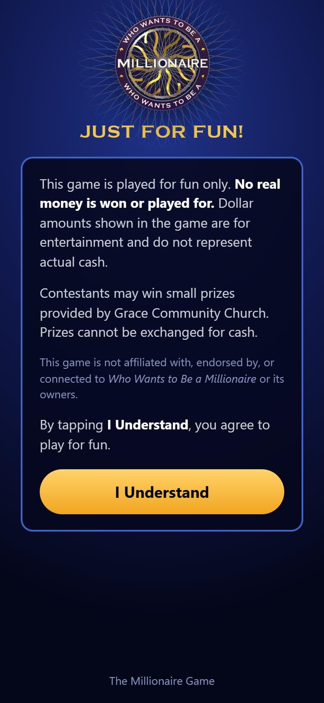 |

| Joining (with "a little about you") | Fastest Finger — answering | Fastest Finger — answer sent |
|---|---|---|
| 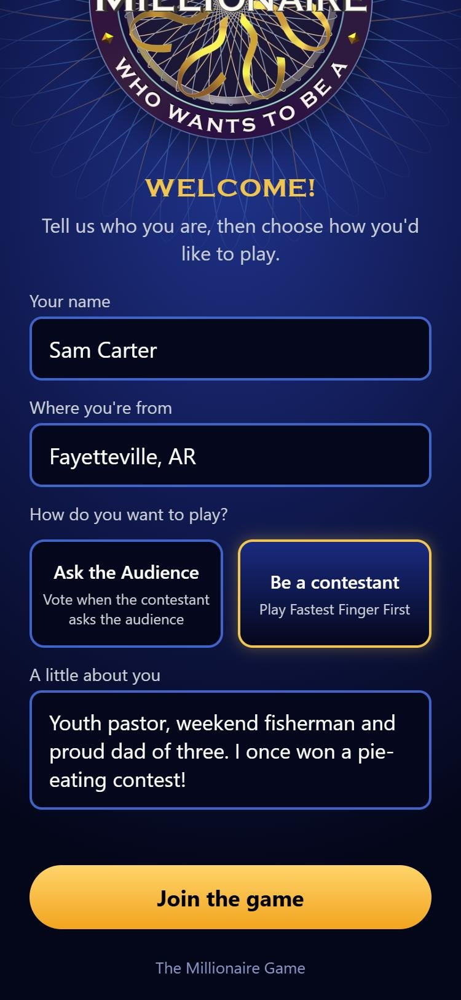 | 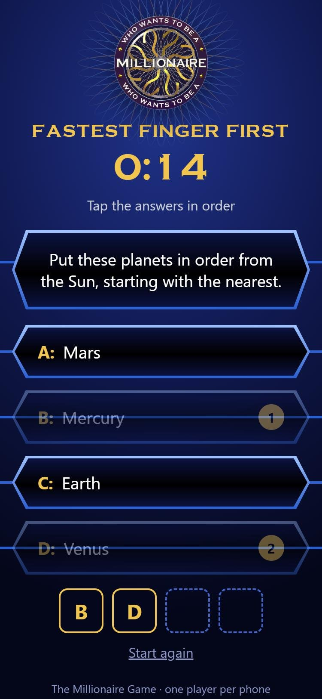 | 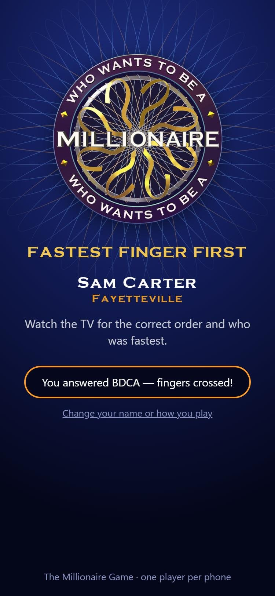 |

| Fastest Finger — the winner | Right, but not fastest | Wrong answer |
|---|---|---|
| 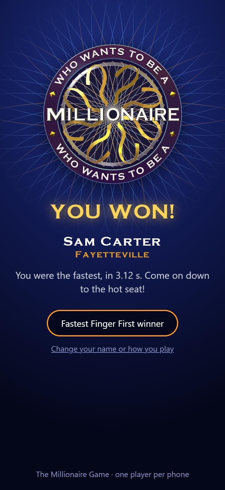 | 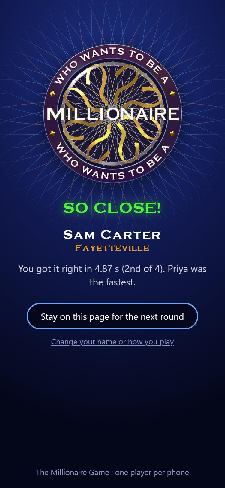 | 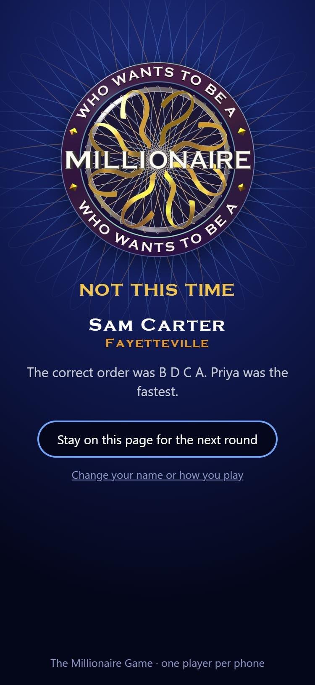 |

| Audience — waiting | Audience — voting | Audience — voting closed |
|---|---|---|
| 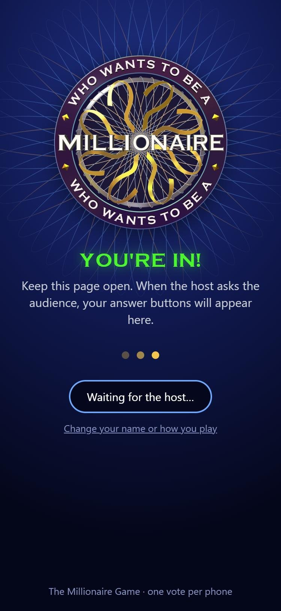 | 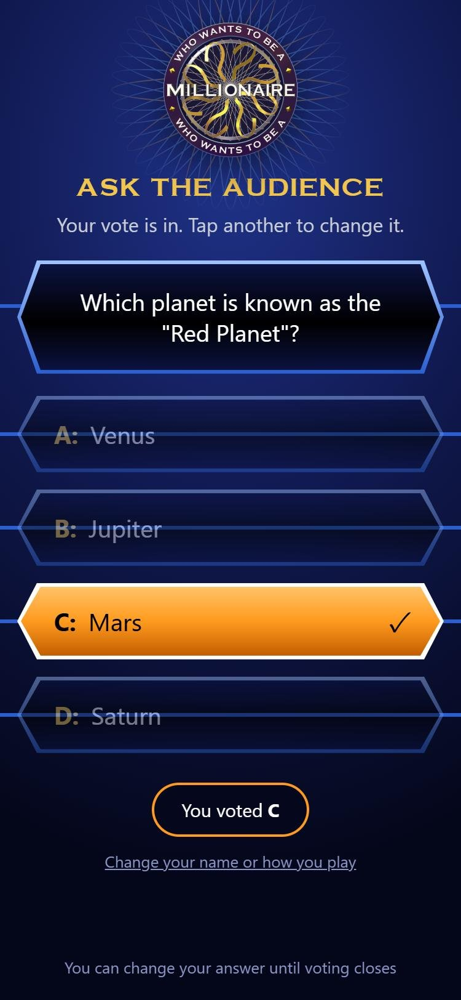 | 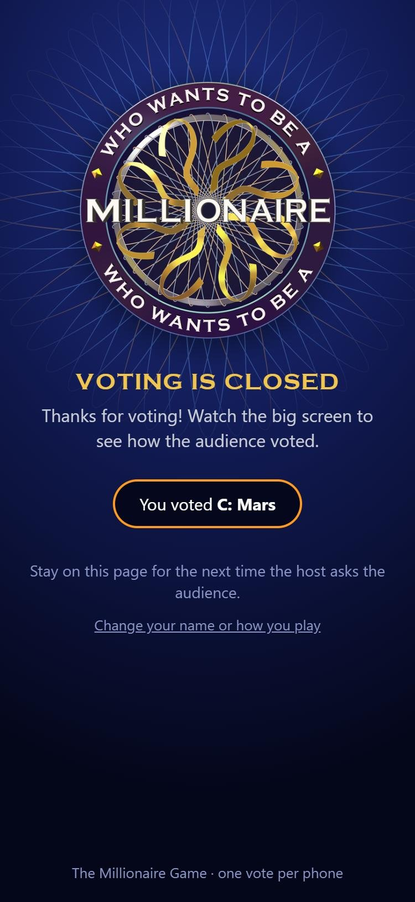 |

| FFF client — answering | FFF client — results |
|---|---|
| 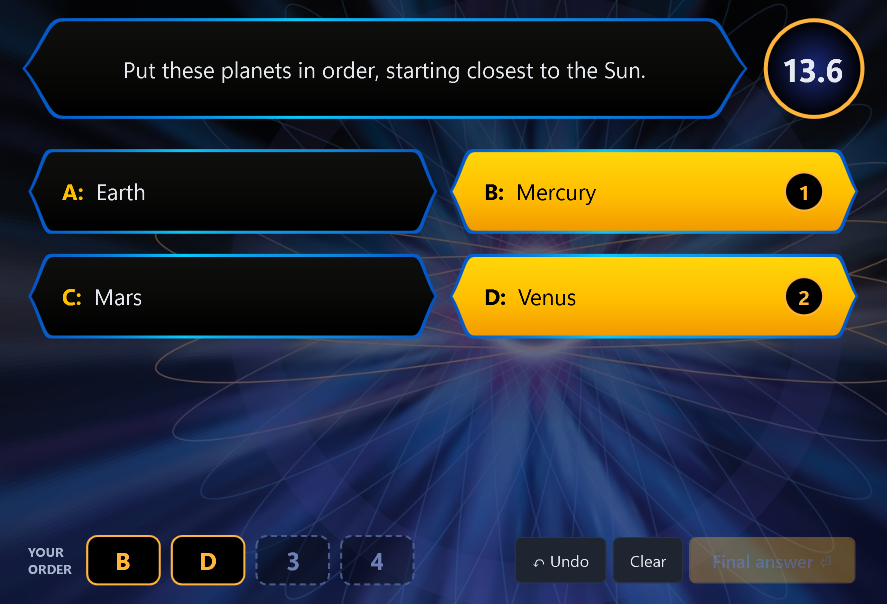 | 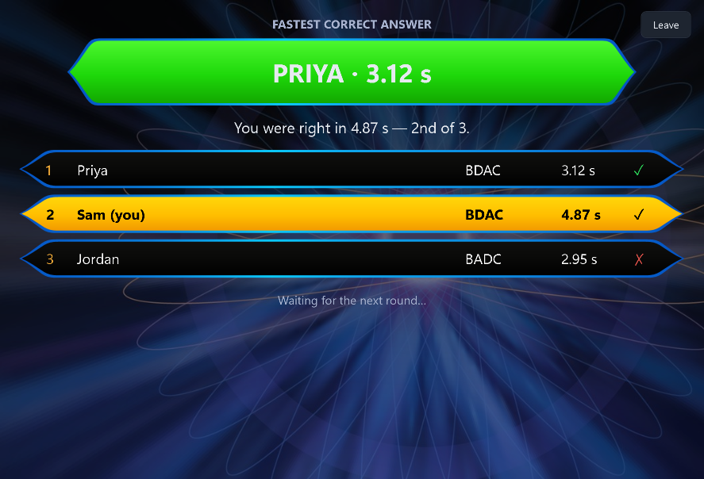 |

## Features

| Area | What you get |
|---|---|
| Screens | Control Panel · Host · Contestant · Audience/TV (optional chroma-key background for OBS) |
| Money tree | The classic 15-question ladder in US dollars; custom amounts, labels and safety nets |
| Show clock | Show length up to 3 hours, Out of Time button, time's-up cue, clock on the Host screen |
| Presentation | Animated logo and backdrop, audience bars, correct-answer flash, end credits timed to the music |
| Lifelines | Up to 4 slots: 50:50, Phone a Friend, Plus One, Ask the Audience, Switch the Question, Double Dip, Ask the Host |
| Unlock rules | Always · After Q5 · After Q10 · Risk Mode |
| Modes | **Risk Mode** (give up safety nets for the extra lifeline) · **Free Safety Net** (contestant picks their own net) |
| Printed props | A winner's check for each contestant and colour-coded badges for host, crew, contestants and audience |
| Single player | No host needed: the computer hosts, with a simulated audience and friend on the phone |
| Fastest Finger First | Local and online. The in-app SignalR server times every answer on arrival, so clients can't cheat on timing |
| Questions | Categories (a game draws from one), topics, built-in editor, CSV/JSON import and export, used-question tracking |
| Sound | Cue-based sound engine (NAudio) with swappable sound packs |
| Contestants | Running order (drag to reorder), random picker, tonight's results with how each game ended |
| Operator | Take back (undo) any step · configurable keyboard shortcuts · an unfinished game carries on after a restart |

## Credits

- **Artwork** — all logos and images in this game were created in **Adobe Illustrator** in **4K**.
- **Logo lettering and medallion style** after the free logo recreations by **ZoranixOG**
  ([millionairefans.net](https://millionairefans.net/thread/4642/olga-logos-recreation-free-templates)),
  used with credit as the author asks.
- **Original game** — *The Millionaire Game* by Macronair, whose sound pack and graphics inspired this rewrite.

## License

© 2026 Comp-U-Temp Productions Inc. All rights reserved. Private project, not for distribution.
